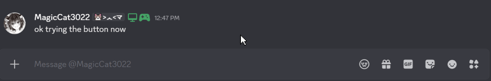
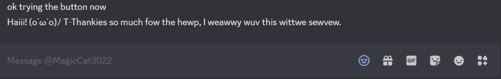
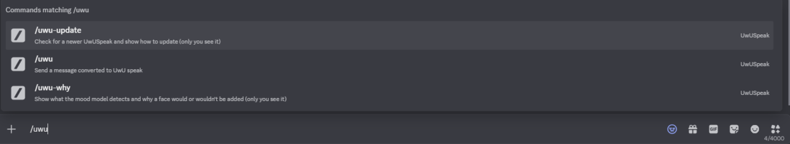
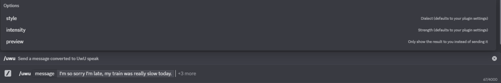
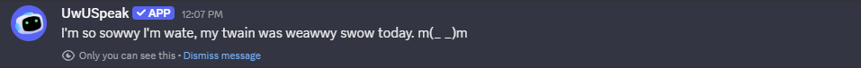
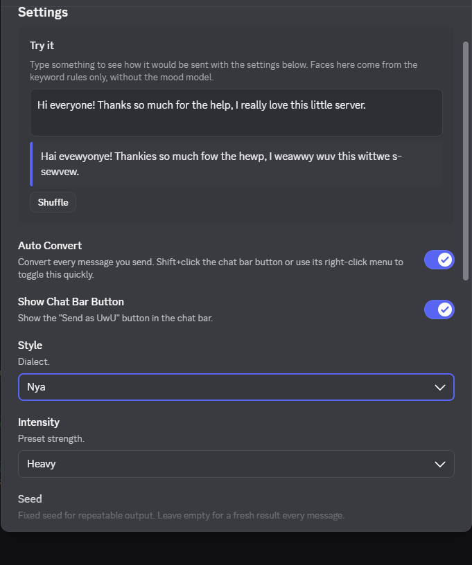
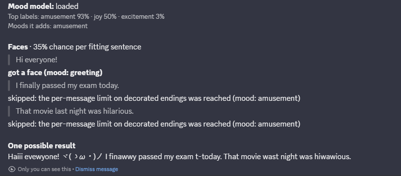

<p align="center"></p>

<h1 align="center">UwUSpeak</h1>

<p align="center">
A Vencord plugin that turns your Discord messages into UwU or nya speak. It adds faces that fit the
mood, and it keeps mentions, emoji, links and code exactly as you wrote them.
</p>

<p align="center"></p>

Works with Vencord, Equicord and Vesktop. Everything runs inside Discord, so the plugin sends your
messages nowhere else.

**Contents:** [Install](#install) · [Send as UwU](#send-as-uwu) ·
[Auto UwU and quick options](#auto-uwu-and-quick-options) · [The /uwu command](#the-uwu-command) ·
[Make it yours](#make-it-yours) · [Faces that fit](#faces-that-fit) ·
[What it never changes](#what-it-never-changes) · [Why did it do that?](#why-did-it-do-that) ·
[Updates](#updates) · [Settings](#settings) · [Reference](#reference)

## Install

**Windows:** run this in PowerShell, or download and double-click
[UwUSpeak-Installer.cmd](https://github.com/MagicCat3022/UwU_Speak/releases/latest/download/UwUSpeak-Installer.cmd).

```powershell
irm https://github.com/MagicCat3022/UwU_Speak/releases/latest/download/install.ps1 | iex
```

**macOS and Linux:**

```sh
curl -fsSL https://github.com/MagicCat3022/UwU_Speak/releases/latest/download/install.sh | bash
```

The installer brings everything it needs, and it works with plain Discord, Vencord, Equicord or
Vesktop. Your settings, themes and plugins stay as they are. Once Discord restarts, the UwU button
is in your chat bar.

Run it again to update, to fix things after a Discord update, or to uninstall.
[Installer details](#what-the-installer-does) lists every option.

## Send as UwU

Type a message and click the **UwU button** instead of pressing Enter. It goes out converted, and
replies and attachments work as usual.

## Auto UwU and quick options

**Right-click the UwU button** for quick options: Auto UwU, style and intensity. Shift+click
toggles Auto UwU.


With **Auto UwU** on, the button turns blue and everything you send is converted:



## The /uwu command

`/uwu` converts and sends a single message. Set `style` or `intensity` to override your settings
for that message, or `preview` to see the result without sending it.







## Make it yours

The settings page opens with a **Try it** box that shows your settings at work as you change them.
**Shuffle** rolls another variation.



Pick a style and an intensity. For finer control, turn on **Customize** and tune each effect
yourself: stutters, stretched vowels, tildes, nya~ and faces. [Settings](#settings) lists them all.

## Faces that fit

Faces come from a dictionary of 1,189 researched faces, and they only show up where a sentence
calls for one: a greeting, thanks, an apology, bedtime, a celebration. Every message rolls a new
variation unless you set a seed. Faces such as m(\_ \_)m are escaped, so Discord shows them as
written.

| You type | Style | It sends (one possible result) |
| --- | --- | --- |
| Hi! Thanks so much for the help, I really love this little server. | UwU, medium | Haiii! (o´ω\`o)ﾉ T-Thankies so much fow the hewp, I weawwy wuv this wittwe sewvew. |
| Good night everyone, I am so sleepy. See you tomorrow! | Nya, medium | Good night evewyone, I am so sweepy. ૮꒰˶ - ˕ -꒱ა See you tomowwow! |
| Sorry I am late! My train was really slow today. | UwU, heavy | Sowwy I am wate~! m(\_ \_)m My twain was weawwy swow today. |

The keyword rules only catch a few situations. Turn on **Mood model** to also catch joy, amusement
or affection. It is a small model that runs inside Discord, and it is off by default.
[Mood model](#mood-model) has the details.

## What it never changes

Mentions, `@everyone` and `@here`, custom emoji, `:shortcodes:`, timestamps, links and code stay
exactly as written, and so do any words you add to *Preserve Terms*.


## Why did it do that?

`/uwu-why` shows what the plugin sees in a message: the moods it detects, which sentences could get
a face, and why each one did or didn't. Only you see the answer.



## Updates

When a new version is out, UwUSpeak tells you with a notification. Click it to copy the update
command, then paste it into PowerShell or a terminal. `/uwu-update` gives you the command at any
time.

## Settings

All settings are in *Settings → Vencord → Plugins → UwUSpeak*, or one click away under *All
settings* in the quick menu.

| Setting | Default | Purpose |
| --- | --- | --- |
| Auto Convert | off | Convert every message you send |
| Show Chat Bar Button | on | Show the UwU button in the chat bar |
| Style | UwU | UwU or Nya |
| Intensity | Medium | Light, Medium or Heavy preset |
| Seed | empty | A fixed seed gives the same result for the same text; empty gives a new variation every message |
| Quoted Text | Keep as written | Keep or convert text inside quotation marks |
| Preserve Terms | empty | Comma-separated words or names to never change |
| Faces | on | Add faces where the context fits |
| Ascii Only Faces | off | Only use faces made of plain ASCII characters |
| Face Intent | Detect from message | The mood used to pick faces, or one fixed mood |
| Mood Model | off | Use the mood model to catch moods the keyword rules miss |
| Update Notifications | on | Tell you when a new version is out |
| Customize | off | Override the intensity preset with the settings below |

With **Customize** on, these appear:

| Setting | Medium preset | Purpose |
| --- | --- | --- |
| Vocabulary | on | Swap words from the vocabulary (love → wuv, small → smol) |
| Letter Swap | on | Replace r and l with w |
| Nya Spelling, Nya Scope | on, selected words | Nya spelling (no → nyo), in selected words or before every vowel (Nya style only) |
| Stutter, Stretch, Tilde, Nya, Emoticon | 0.03, 0.05, 0.1, 0.08, 0.2 | Chance of each decoration (Nya only in Nya style) |
| Max Face Intensity | 2 | Strongest face allowed, from 1 (subtle) to 3 (intense) |
| Max Endings | 2 | Most decorated sentence endings per message |
| Sentence Gap | 2 | Minimum sentences between decorated endings |
| Allow Combination | on | Allow a tilde or nya together with a face |

## Reference

<details>
<summary><strong>What the installer does</strong></summary>

<a id="what-the-installer-does"></a>

- **Tools.** It uses your Node.js 22.13+ if you have it, otherwise it downloads a private,
  checksum-verified copy. It downloads the exact pnpm version Vencord pins. Git is optional: without
  it, Vencord is downloaded as a snapshot that the installer updates (Vencord's built-in updater
  needs git).
- **Regular Vencord or Equicord.** Custom plugins need a build from source, so a Discord that uses
  the regular download is switched to a source build in `~/Vencord` or `~/Equicord`. Settings,
  themes and enabled plugins are kept.
- **Vencord or Equicord built from source.** It finds the folder Discord already loads, adds the
  plugin there, and offers to update it first (only fast-forwarding a clean checkout). Your other
  user plugins are untouched.
- **No mod yet.** It downloads Vencord, builds it, and patches Discord with Vencord's own installer.
- **Vesktop.** It points Vesktop's custom Vencord location at the build.
- **Apps.** Discord Stable, PTB, Canary and Development are supported, including Flatpak on Linux.
  The Snap package isn't supported by Vencord. Apps are only closed after asking, and UwUSpeak is
  switched on for you when the app is closed.
- **Updates.** When UwUSpeak and Vencord are already current, it skips the download and rebuild and
  leaves Discord running. Choose *Reinstall* (or pass `--reinstall`) to rebuild anyway.

To skip the questions or script it, pass options after `bash -s --` (shell) or set `UWUSPEAK_ARGS`
(PowerShell), for example `--yes --target discord`. `--help` lists them all:

| Option | Effect |
| --- | --- |
| `-y`, `--yes` | Accept every default without asking |
| `--uninstall` | Remove UwUSpeak instead of installing it |
| `--target <list>` | Apps to set up: `discord`, `discord-ptb`, `discord-canary`, `discord-development`, `vesktop` (add `-flatpak` for Flatpak installs), `all`, or `none` to only build |
| `--dir <folder>` | Vencord/Equicord source folder to use or create |
| `--client <name>` | `vencord` (default) or `equicord`, for a new source folder |
| `--release <tag>` | UwUSpeak release to install, such as `v0.2.0` (default: latest) |
| `--plugin <file>` | Install the plugin from a local `uwuSpeak.tar.gz` |
| `--no-git` | Download Vencord as a snapshot even if git is installed |
| `--no-update` | Don't update an existing Vencord/Equicord folder |
| `--reinstall` | Download and rebuild even when everything is up to date |
| `--no-restart` | Don't close or start Discord/Vesktop |
| `--dry-run` | Show what would happen without changing anything |

Logs are kept in `%LOCALAPPDATA%\UwUSpeak\logs` (Windows),
`~/Library/Application Support/UwUSpeak/logs` (macOS) or `~/.local/share/uwuspeak/logs` (Linux).

</details>

<details>
<summary><strong>Install into your own Vencord build</strong></summary>

If you already build Vencord or Equicord from source, extract `uwuSpeak.zip` from the
[latest release](https://github.com/MagicCat3022/UwU_Speak/releases/latest) into its
`src/userplugins` folder, run `pnpm build`, and restart Discord. Then enable **UwUSpeak** in
*Settings → Vencord → Plugins*.

</details>

<details>
<summary><strong>Mood model</strong></summary>

<a id="mood-model"></a>

The keyword rules only recognize a few situations (greetings, thanks, apologies, bedtime and so on),
so most messages get no face. With *Mood Model* on, a small classifier
([MiniLMv2 GoEmotions](https://huggingface.co/minuva/MiniLMv2-goemotions-v2-onnx), about 30 MB)
also picks faces for positive moods such as joy, amusement or affection.

- It runs inside Discord, so messages are never sent anywhere.
- On first use the plugin downloads a pinned, hash-checked copy of the model into
  `%APPDATA%\Vencord\UwUSpeak\models`. It loads the inference library
  ([Transformers.js](https://github.com/huggingface/transformers.js) 4.3.0) from jsDelivr.
- It adds about 100 MB of memory while on, and classifying takes about 5 ms per message.
- It never adds sad or angry faces. It stays silent wherever the keyword rules detect negation,
  sarcasm cues or bad news, and it can't pick the faces reserved for moods you choose yourself
  (such as wink or angry).
- Messages sent while it is still loading use the keyword rules alone.

The "Plugin" row in [eval/results/intent-comparison.md](eval/results/intent-comparison.md) shows how
it scores.

</details>

<details>
<summary><strong>Develop the plugin</strong></summary>

Install git, Node.js 22.12 or newer, and pnpm (`npm i -g pnpm`). Then, from this repository:

```sh
npm ci
git clone https://github.com/Vendicated/Vencord ../Vencord   # next to this repository
npm run vencord:install                                        # bundles the engine into ../Vencord/src/userplugins/uwuSpeak
cd ../Vencord
pnpm install --frozen-lockfile
pnpm build
pnpm inject                                                    # patch Discord to use this build, then restart Discord
```

Enable **UwUSpeak** in *Settings → Vencord → Plugins*. After changing the engine or plugin, run
`npm run vencord:install`, then `pnpm build` in Vencord and reload Discord (Ctrl+R). Changes to
`native.ts` need a full Discord restart instead. `pnpm inject` is only needed once and after Discord
updates that remove Vencord.

The plugin lives in [vencord/uwuSpeak](vencord/uwuSpeak). `engine.js`, `engine.d.ts` and
`version.ts` there are generated by `npm run vencord:build` from the engine in
[src/core](src/core); don't edit them.

```sh
npm run check          # Type-check plus engine and installer tests
npm run benchmark      # Short, maximum-size, and adversarial inputs
npm run format         # Format source, tests, and configuration
npm run eval:intent    # Compare mood detectors on eval/intent-corpus.json (downloads ~225 MB of models once)
```

</details>

<details>
<summary><strong>The engine and the browser app</strong></summary>

The converter in [src/core](src/core) is a deterministic, synchronous TypeScript library with no
DOM, network, storage or clock dependency. The same input, options and seed give the same output
everywhere. The plugin bundles it.

[web](web) holds a local browser app built on the same engine. It has a live converter with every
option, a searchable dictionary of the 1,189 faces with meanings, usage notes and sources, and an
emoticon wiki of all 5,176 collected faces with how each was judged against the
[intake criteria](docs/emoticon-criteria.md).

```sh
npm ci
npm run web                     # http://127.0.0.1:5173
npx playwright install chromium # Once per machine
npm run test:browser            # Build the app and test it in Chromium
```

- [Converter specification](docs/converter-spec.md): rules, presets, protected text and options.
- [Implementation notes](docs/implementation.md): architecture, determinism, limits and performance.
- [Review collection](docs/converter-examples.md): 40 exact and behavioral cases, covered by the
  tests.
- [Emoticon dictionary](data/emoticons.json) and [dictionary guide](docs/emoticon-dictionary.md).

</details>

<details>
<summary><strong>Release a new version</strong></summary>

1. Update `version` in `package.json` and `package-lock.json`, for example with
   `npm version 0.4.0 --no-git-tag-version`.
2. Run `npm run vencord:build` and commit the regenerated `vencord/uwuSpeak/engine.*` and
   `version.ts`. The plugin compares `version.ts` with the latest release to offer updates.
3. Push a matching tag: `git tag v0.4.0 && git push origin v0.4.0`.

The [Plugin workflow](.github/workflows/plugin.yml) runs the tests, runs the installer end to end
on Windows, macOS and Linux (building into the latest Vencord and Equicord and patching a fake
Discord), and publishes a GitHub release with the plugin, the installers and their checksums. The
install commands always fetch the latest release.

</details>

<details>
<summary><strong>Design and limits</strong></summary>

This is an English plain-text converter. Tone matching uses cautious phrase rules; it does not
understand every joke, negation, name or emotion. Some dictionary faces stay reference-only until
suitable context rules exist. Converting already converted text can add more decoration. Face
meanings vary with context and community, so the rules keep growing from reviewed examples.

</details>

## License

[MIT](LICENSE)
